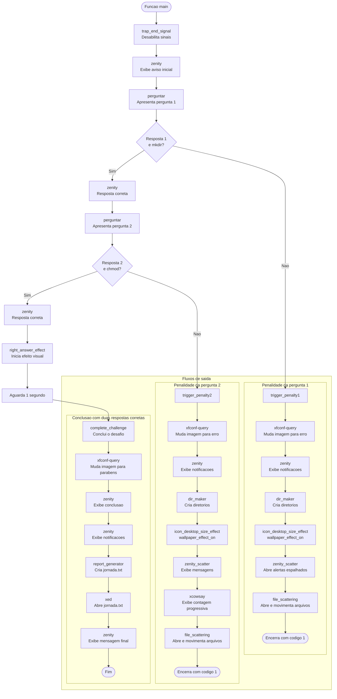
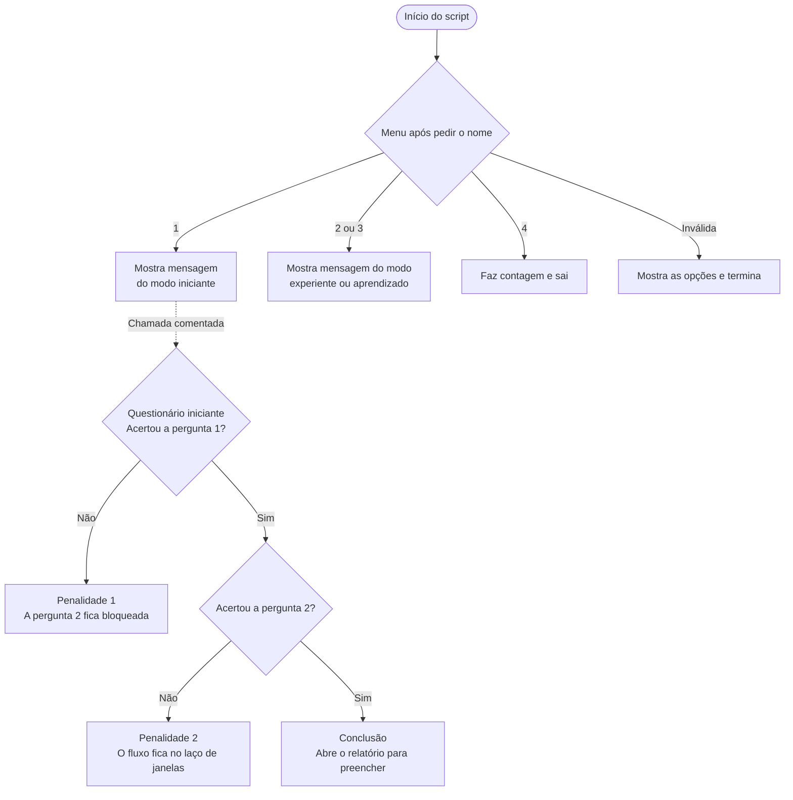
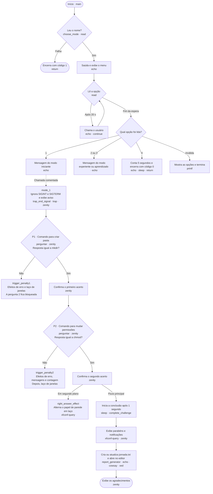

# Questionario Interativo fluxograma versão original estrutura prévia

Fluxograma baseado no script [`Questinario-Interativo`](./Questinario-Interativo), na branch `development-area`.

> # Questionário Interativo — dois fluxogramas - nova estrutura

Baseado na versão de 21/11/2026 do script `Questinario-Interativo`. A **seta pontilhada** marca a chamada comentada de `mode_1`. Na execução atual, o Bash passa por `main` e `choose_mode`. As perguntas e seus efeitos pertencem ao ramo pontilhado.

## 1. Visão geral do código

As opções **1, 2 e 3** só exibem mensagens antes de o script terminar. Enquanto espera pela opção do menu, o script repete a pergunta após 20 segundos de inatividade.

## 2. Processos e consequências descritos

Os nomes junto às ações indicam as funções e os comandos usados pelo script. Nas perguntas, `mkdir` e `chmod` são as respostas esperadas.

### O que acontece nas penalidades

1. **Preparação comum.** `xfconf-query` tenta exibir a imagem de erro. Depois de uma pausa com `sleep`, `zenity` dispara notificações e `dir_maker` tenta criar 200 pastas na Área de Trabalho com `mkdir`. O script usa `wait` para aguardar os trabalhos em segundo plano já iniciados.
2. **Efeitos comuns.** `icon_desktop_size_effect` e `wallpaper_effect_on` iniciam alterações contínuas no tamanho dos ícones e no papel de parede. `zenity_scatter` abre alertas e usa `wmctrl` para reposicionar janelas.
3. **Diferença entre os erros.** A penalidade 1 segue dos alertas para `file_scattering`. A penalidade 2 inicia os alertas em segundo plano e também exibe mensagens ilustradas e uma contagem com `xcowsay_size_image_dialog` e `xcowsay`, antes de entrar em `file_scattering`.
4. **Consequência comum.** `file_scattering` abre e reposiciona janelas com `xed` e `wmctrl` em um laço sem saída. Na penalidade 1, isso impede o avanço à pergunta 2. Na penalidade 2, impede o retorno normal da função. As chamadas de `disable_input_devices` estão comentadas nas duas penalidades.

### O que acontece após dois acertos

`right_answer_effect` continua alternando imagens em segundo plano, inclusive depois que `complete_challenge` tenta definir a imagem de parabéns. `report_generator` acrescenta texto a `jornada.txt` na Área de Trabalho e abre o arquivo para preenchimento. A mensagem de agradecimento aparece após o comando `xed` devolver o controle ao script.
